# Gestion des contacts V3 — Fragments · RecyclerView · Filtrage · Google Maps

Évolution de l'application de gestion de contacts (TP V2) : une **activité unique** qui héberge des **fragments dynamiques**,
une **RecyclerView filtrable** et l'affichage des **coordonnées GPS** sur **Google Maps**. Kotlin + XML, stockage en mémoire.

> Navigation rapide : [Compte rendu](compte-rendu/compte-rendu.md) ([PDF](compte-rendu/compte-rendu.pdf)) ·
> [Captures d'écran](captures/README.md) · [Code](app/src/main/java/com/example/contactsv3/) ·
> [Tests unitaires](app/src/test/java/com/example/contactsv3/model/)

## Parcours utilisateur

```
Liste des contacts ──(saisie d'un filtre)──▶ clic sur un contact
        ▲                                         │
        │ Enregistrer / Annuler / Retour          ▼
        └──────────────────────────────── Fiche détail ──▶ « Voir sur la carte » ──▶ Carte + marqueur
                                           (modifier, appeler, e-mail,                     │
                                            galerie, caméra, GPS)  ◀──── Retour ───────────┘
```

## Captures d'écran

| Liste complète | Liste filtrée | Aucun résultat |
|:-:|:-:|:-:|
| 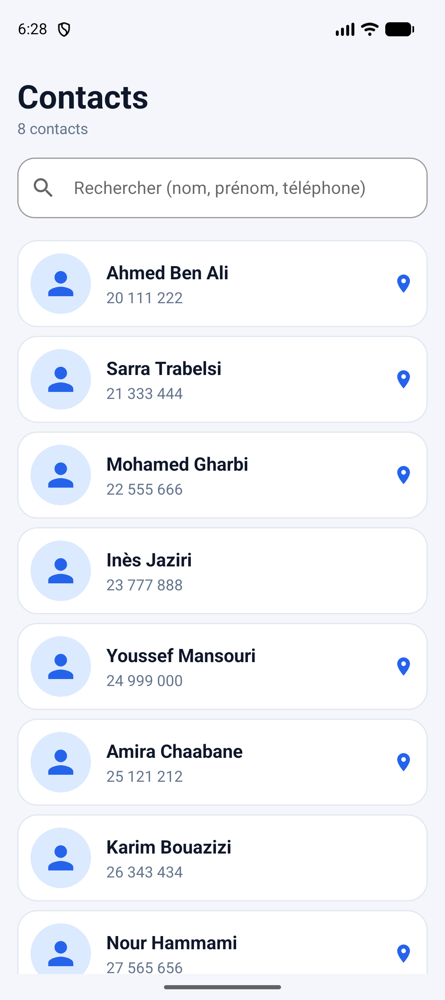 | 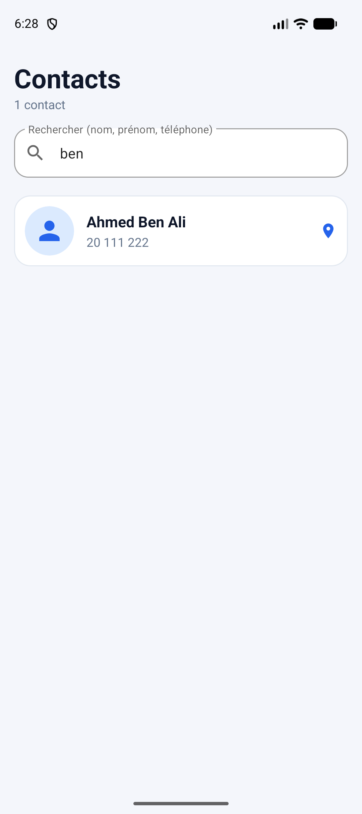 | 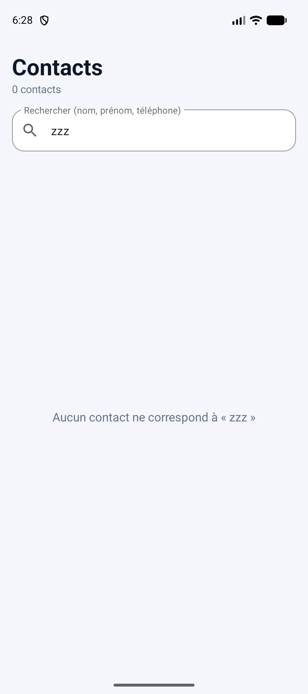 |

| Fiche détail | Modification | Erreurs de validation |
|:-:|:-:|:-:|
| 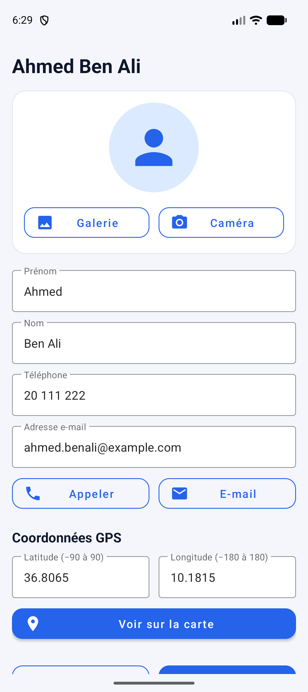 | 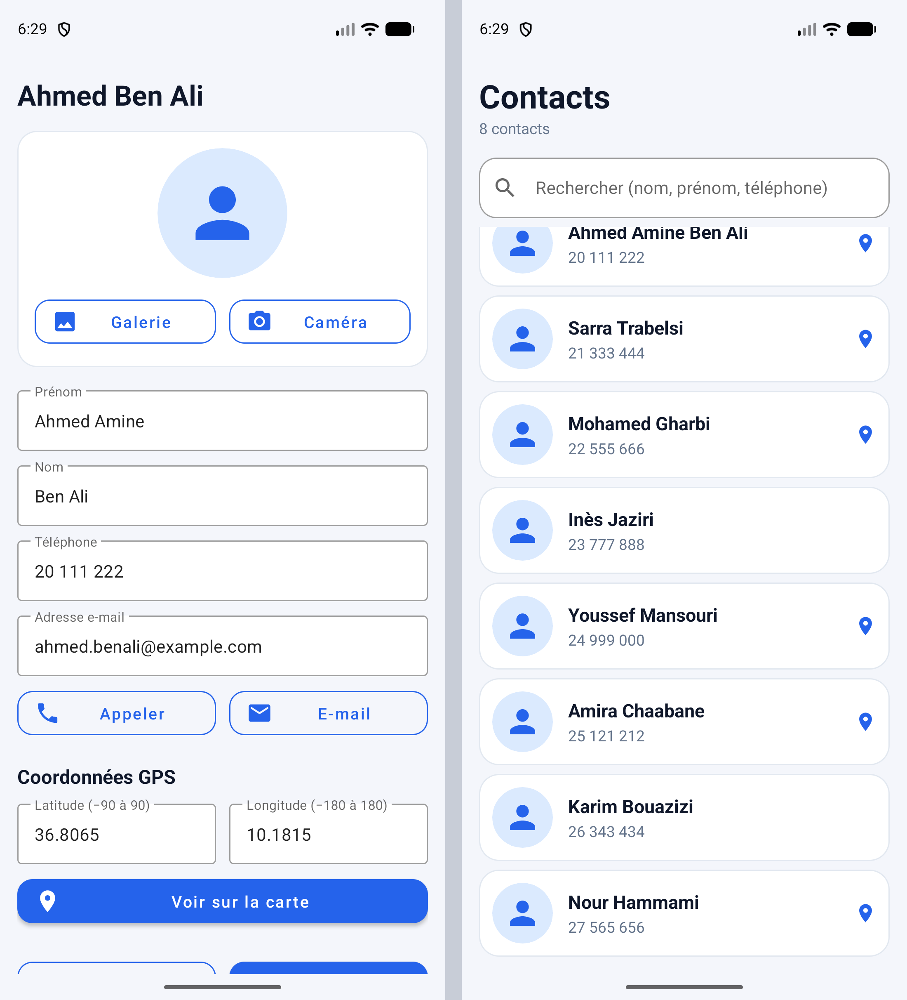 | 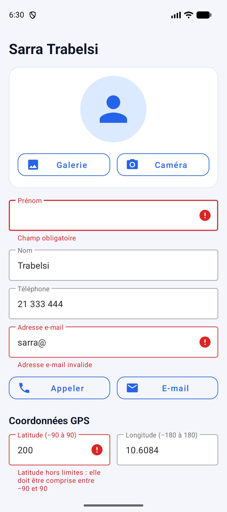 |

| Galerie | Caméra | Carte + marqueur |
|:-:|:-:|:-:|
| 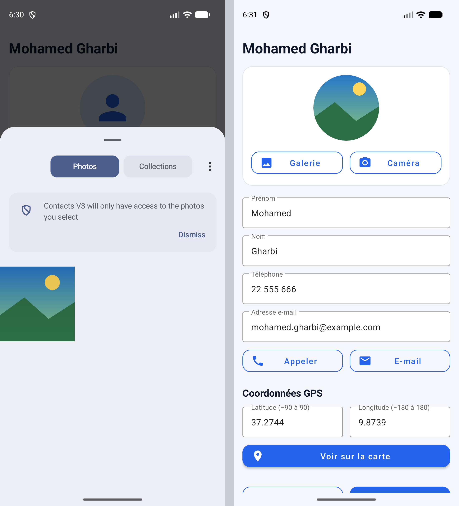 | 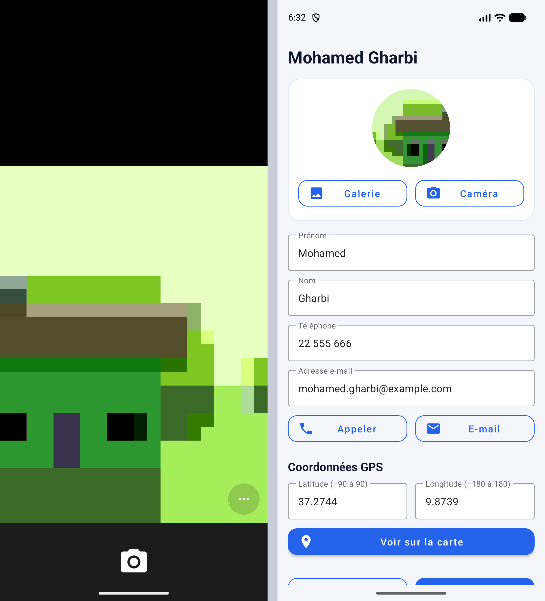 | 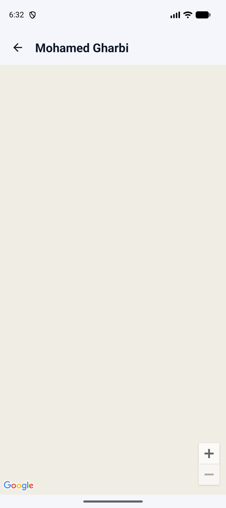 |

| Contact sans position | Appel | E-mail |
|:-:|:-:|:-:|
| 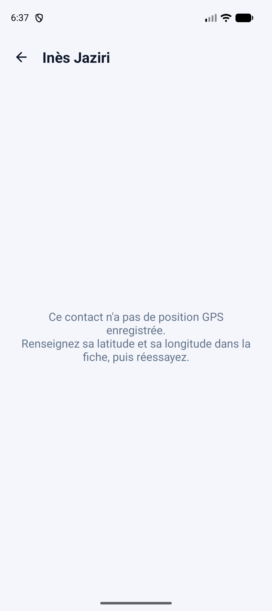 | 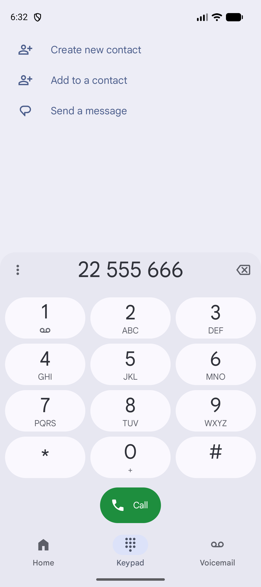 |  |

| Après rotation |
|:-:|
| 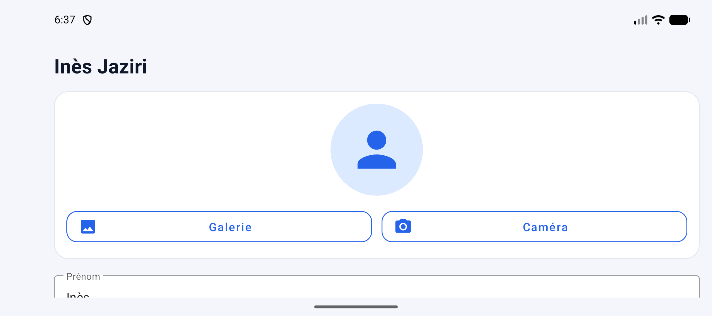 |

## Fonctionnalités

**V2 conservées**
- Modèle `Contact` : nom, prénom, téléphone, e-mail, photo (+ latitude / longitude en V3)
- Consultation, modification et enregistrement ; **Annuler** conserve les anciennes valeurs
- **Appeler** (`ACTION_DIAL`) et **E-mail** (`ACTION_SENDTO` + `mailto:`, adresse préremplie)
- **Galerie** (`GetContent`) et **Caméra** (`TakePicture` + `FileProvider`), annulations et applications absentes gérées
- Champs obligatoires (prénom, nom, téléphone) et e-mail validé

**Nouveautés V3**
- `MainActivity` + `FragmentContainerView` ; `ListeContactsFragment`, `DetailContactFragment`, `CarteContactFragment`
- Navigation `replace()` + `addToBackStack()` ; identifiant du contact passé par `Bundle`
- **ViewModel partagé** : la liste se met à jour toute seule après un enregistrement, même après rotation
- **RecyclerView** (`ListAdapter` + `DiffUtil`) : photo, prénom + nom, téléphone
- **Recherche en direct** (nom, prénom, « prénom nom », téléphone) : insensible à la casse et aux accents, message si aucun résultat
- **Latitude / longitude** modifiables avec validation (−90…90 / −180…180), message explicite si absentes ou invalides
- **Google Maps** : carte centrée sur le contact, marqueur à son nom, retour correct vers la fiche
- Rotation sans fragments en double (le premier fragment n'est ajouté que si `savedInstanceState == null`)

## Ouvrir et lancer le projet

1. Installer **Android Studio** (récent) avec le SDK Android 35.
2. `File > Open…` → dossier `ContactsV3` ; laisser Gradle se synchroniser (Gradle Wrapper 8.9 inclus).
3. **Configurer la clé Google Maps** (voir ci-dessous) — sans elle, tout fonctionne sauf le fond de carte (écran gris).
4. Lancer ▶ sur un émulateur *avec Google Play services* (image « Google APIs / Google Play ») ou sur un téléphone.

Tests unitaires (logique du filtre, des coordonnées, des validations) :

```bash
./gradlew test            # Windows : gradlew.bat test
```

## Clé Google Maps — sans jamais la publier

La clé **n'est écrite dans aucun fichier versionné**. Elle est lue au moment de la compilation et injectée dans le manifeste
(`android:value="${MAPS_API_KEY}"`).

1. Dans la [Google Cloud Console](https://console.cloud.google.com/) : créer un projet, activer **Maps SDK for Android**,
   puis créer une **clé d'API** (la facturation peut être exigée par Google selon ses conditions).
2. *Recommandé* : restreindre la clé à votre application (nom de paquet `com.example.contactsv3` + empreinte SHA-1 de votre
   certificat de debug) et à l'API *Maps SDK for Android*.
3. Copier `local.properties.example` en `local.properties` (ou ouvrir celui qu'Android Studio a créé) et ajouter :

   ```properties
   MAPS_API_KEY=votre_cle_ici
   ```

   (Variante : définir la variable d'environnement `MAPS_API_KEY`, utile pour l'intégration continue.)
4. `local.properties` est dans `.gitignore` : **vérifiez avec `git status`** qu'il n'apparaît pas avant chaque commit.

> Si une clé a déjà été commitée par erreur : la **révoquer / régénérer** dans la console Google Cloud — la supprimer du dépôt
> ne suffit pas, elle reste dans l'historique Git.

## Structure du dépôt

```
ContactsV3/
├── app/
│   ├── build.gradle.kts                  # injecte MAPS_API_KEY depuis local.properties
│   └── src/
│       ├── main/
│       │   ├── AndroidManifest.xml       # meta-data Maps, FileProvider, permissions INTERNET
│       │   ├── java/com/example/contactsv3/
│       │   │   ├── MainActivity.kt
│       │   │   ├── model/                # Contact, ContactFilter, Coordinates, Validators, DemoData
│       │   │   ├── ui/                   # 3 fragments, ContactAdapter, ContactsViewModel
│       │   │   └── util/                 # PhotoStore (galerie/caméra), extensions
│       │   └── res/                      # layouts, drawables, strings, thèmes, file_paths
│       └── test/                         # tests unitaires (JUnit)
├── captures/                             # captures d'écran (liste à compléter : captures/README.md)
├── compte-rendu/                         # compte rendu (Markdown + PDF)
├── local.properties.example              # modèle de configuration de la clé (SANS clé)
├── gradle/wrapper/, gradlew, gradlew.bat
└── .gitignore                            # exclut local.properties, build/, .gradle/…
```

## Auteur

Obaid Allah — ISET Djerba.
# ContactsV3
